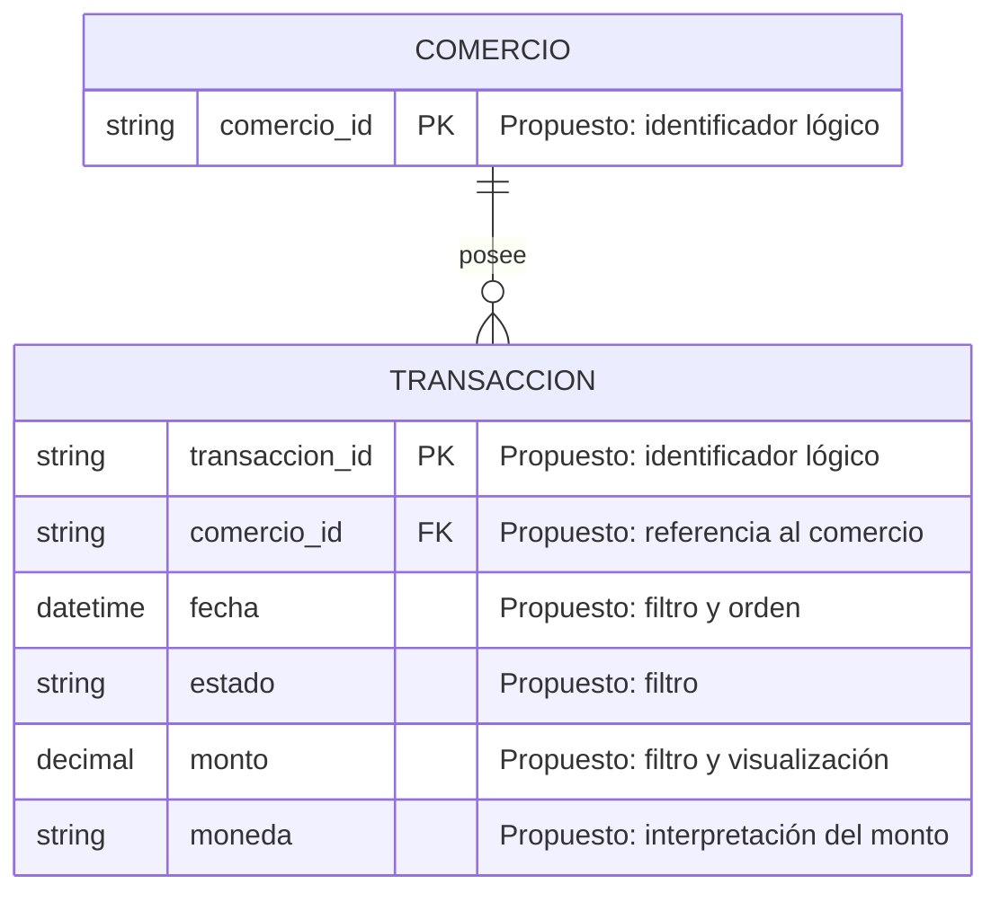

Supuestos:

- La relación Comercio–Transacción se desprende del requisito de aislar las transacciones por comercio.
- Los campos se marcan como propuesta: el PRD no define atributos concretos.
- Se incluyen solo identificadores, fecha, estado, monto y moneda.
- El ERD no implementa autorización, privacidad, límite de 90 días ni concurrencia.

Preguntas abiertas:

- ¿Qué estados de transacción son válidos?
- ¿Qué evento representa la fecha y qué zona horaria aplica?
- ¿Qué moneda, precisión y operadores admite el monto?
- ¿Qué otros campos no sensibles deben mostrarse?
- ¿Cómo se vincula la identidad autenticada con el comercio autorizado?